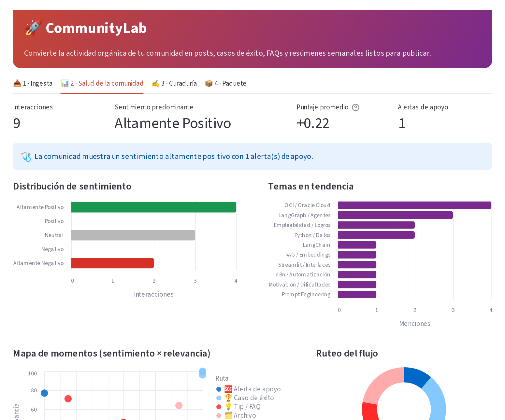
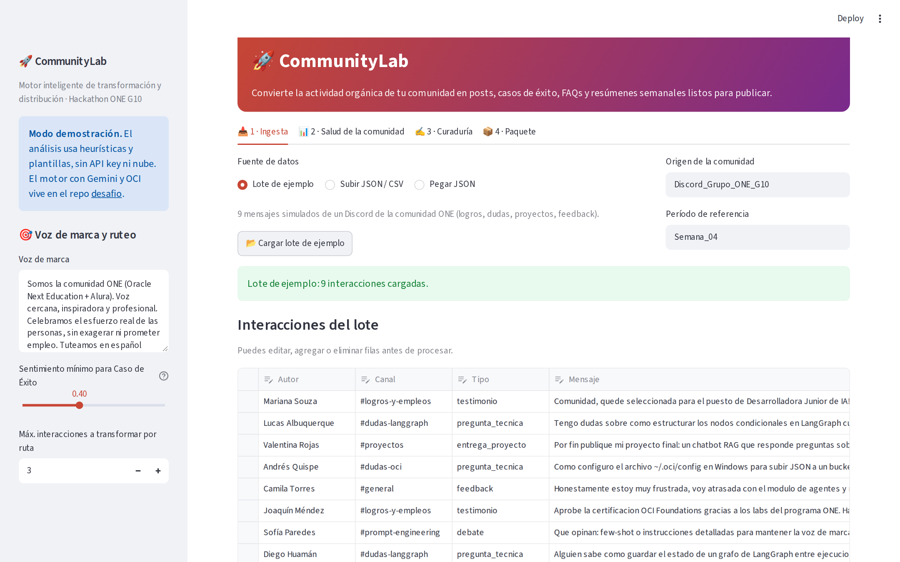
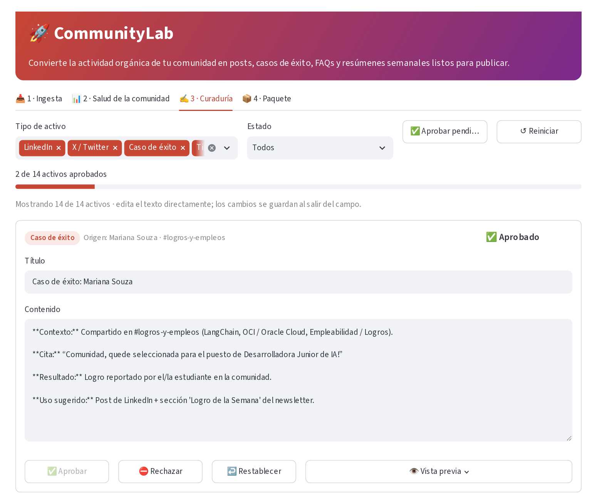
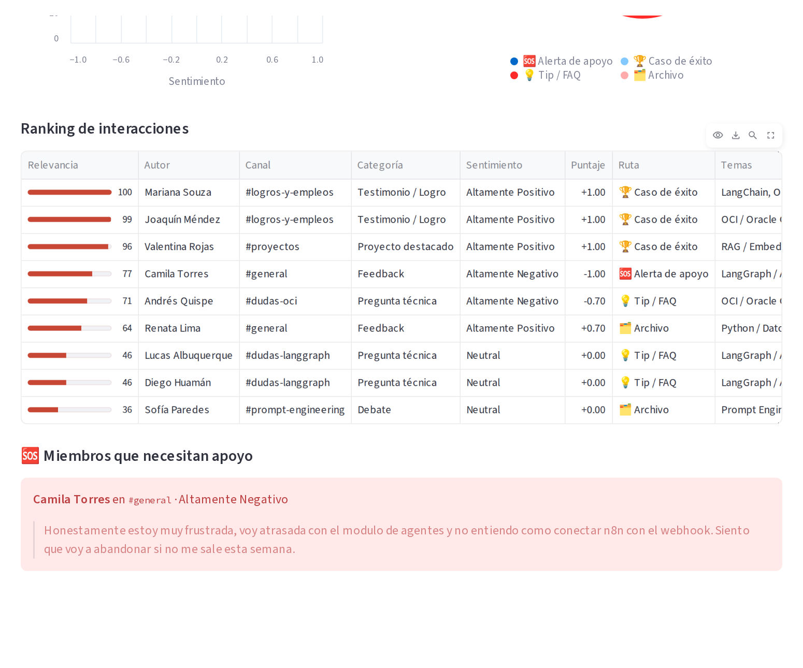
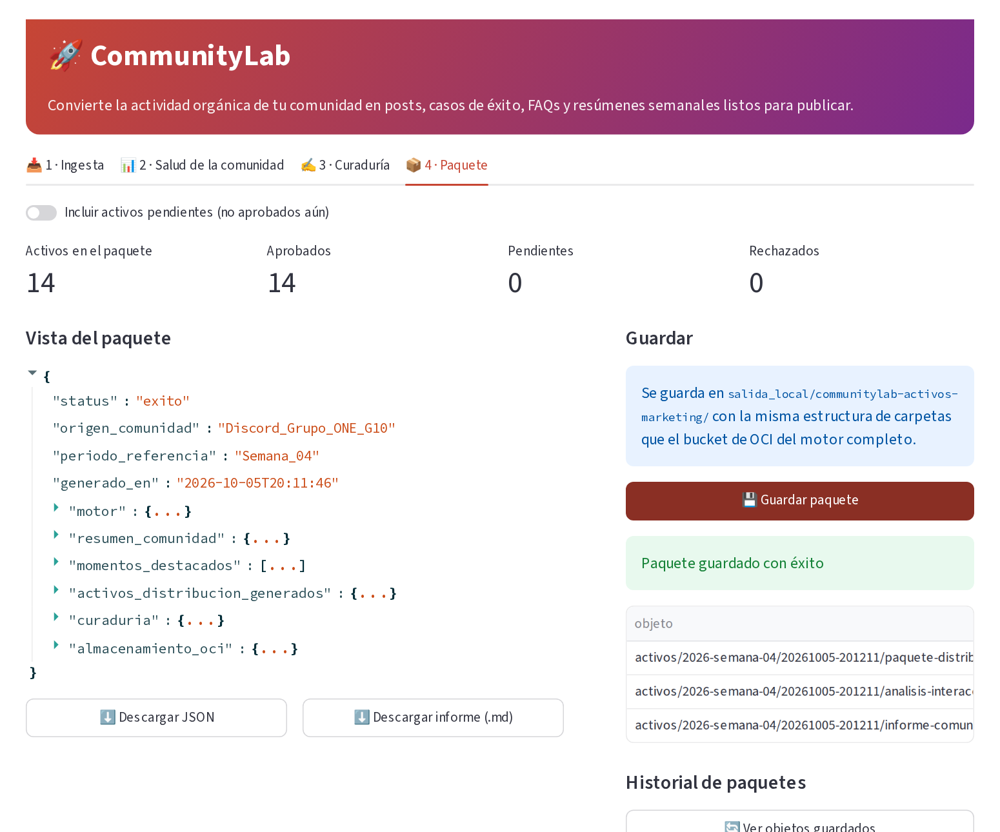

<div align="center">

# 🚀 CommunityLab · Frontend

**Interfaz en Streamlit para convertir las conversaciones de una comunidad tech en contenido listo para publicar.**

Carga un lote de mensajes, muestra la salud de la comunidad y permite al equipo editar, aprobar o rechazar los posts, casos de éxito y FAQs generados. Funciona sola, sin API key ni nube.


*Hackathon ONE G10 · Oracle Next Education + Alura · Reto 3*



</div>

---

## Qué es este repositorio

Es la **capa de presentación** de CommunityLab, separada del motor de IA para que cualquiera pueda clonarla y probarla en un minuto.

| Repositorio | Contenido |
|---|---|
| **desafio2** (este) | Interfaz Streamlit + motor de demostración por heurísticas. Sin dependencias externas. |
| [**desafio**](https://github.com/DiegoTCobba/desafio) | Proyecto completo: análisis con Google Gemini vía LangChain y persistencia en OCI Object Storage. |

El motor de demostración (`motor_demo.py`) respeta el mismo contrato de datos que el motor real, así que la interfaz es idéntica en ambos.

## ✨ Funcionalidades

| Pestaña | Qué hace |
|---|---|
| 📥 **Ingesta** | Carga el lote de ejemplo, un JSON o CSV, o un JSON pegado. Tabla editable antes de procesar y progreso paso a paso. |
| 📊 **Salud de la comunidad** | Métricas, distribución de sentimiento, temas en tendencia, mapa sentimiento × relevancia, reparto por ruta, ranking explicado y alertas de miembros que necesitan apoyo. |
| ✍️ **Curaduría** | Cada activo se edita, aprueba, rechaza o restablece. Filtros por tipo y estado, contador de 280 caracteres para X, vista previa y barra de avance. |
| 📦 **Paquete** | Arma el paquete solo con lo aprobado, lo descarga en JSON o Markdown y lo guarda con la estructura de carpetas del bucket. |

En la barra lateral se ajustan la **voz de marca**, el **umbral de sentimiento** para casos de éxito y el máximo de mensajes a transformar por ruta.

## 🖥 Capturas

| Ingesta | Curaduría |
|---|---|
|  |  |
| **Ranking y alertas** | **Paquete** |
|  |  |

## ⚡ Cómo ejecutarlo

```bat
git clone https://github.com/DiegoTCobba/desafio2.git
cd desafio2
python -m venv .venv
.venv\Scripts\python.exe -m pip install -r requirements.txt
.venv\Scripts\python.exe -m streamlit run app.py
```

> En macOS / Linux: `source .venv/bin/activate` y luego `streamlit run app.py`.

Pulsa **Cargar lote de ejemplo** → **Procesar lote** y recorre las cuatro pestañas.

### Formato de entrada

JSON con el formato del reto, o CSV con las columnas `autor, canal, tipo, texto`:

```json
{
  "origen_comunidad": "Discord_Grupo_ONE_G10",
  "periodo_referencia": "Semana_04",
  "interacciones": [
    {"autor": "Mariana Souza", "canal": "#logros-y-empleos", "tipo": "testimonio",
     "texto": "Comunidad, quede seleccionada para el puesto de Desarrolladora Junior de IA! ..."}
  ]
}
```

## 🧩 Decisiones de interfaz

- **El flujo sigue el trabajo real** de un community manager: cargar, entender la semana, revisar y guardar.
- **Humano en el circuito**: nada entra al paquete sin aprobación, salvo que se active la opción de incluir pendientes.
- **Cada decisión se explica**: el ranking muestra categoría, puntaje, ruta y justificación de cada mensaje.
- **Las alertas no generan contenido**: un mensaje con frustración se muestra al equipo, no se convierte en publicidad.
- **Estado estable**: las etiquetas de las pestañas son fijas, porque Streamlit reinicia la navegación si cambian.

## 🧪 Pruebas

```bat
.venv\Scripts\python.exe -m pip install -r requirements-dev.txt
.venv\Scripts\python.exe -m pytest tests -q
```

Con **Streamlit AppTest** se prueba el flujo completo de la interfaz: cargar, procesar, aprobar, editar y guardar. También se prueban el ruteo del lote de ejemplo y que el paquete solo incluya lo aprobado. Se ejecutan en cada push con GitHub Actions.

## 📁 Estructura

```text
app.py                  interfaz Streamlit (4 pestañas)
motor_demo.py           motor de demostración: heurísticas, ruteo, plantillas y paquete
data/                   lote de ejemplo del reto (9 mensajes)
tests/test_app.py       pruebas de interfaz y del motor
.streamlit/config.toml  tema de la app
docs/img/               capturas
```

## 👤 Autor

**Diego** · [@DiegoTCobba](https://github.com/DiegoTCobba)

---

<sub>Proyecto desarrollado para el Hackathon ONE G10 (Oracle Next Education + Alura). Licencia MIT.</sub>
