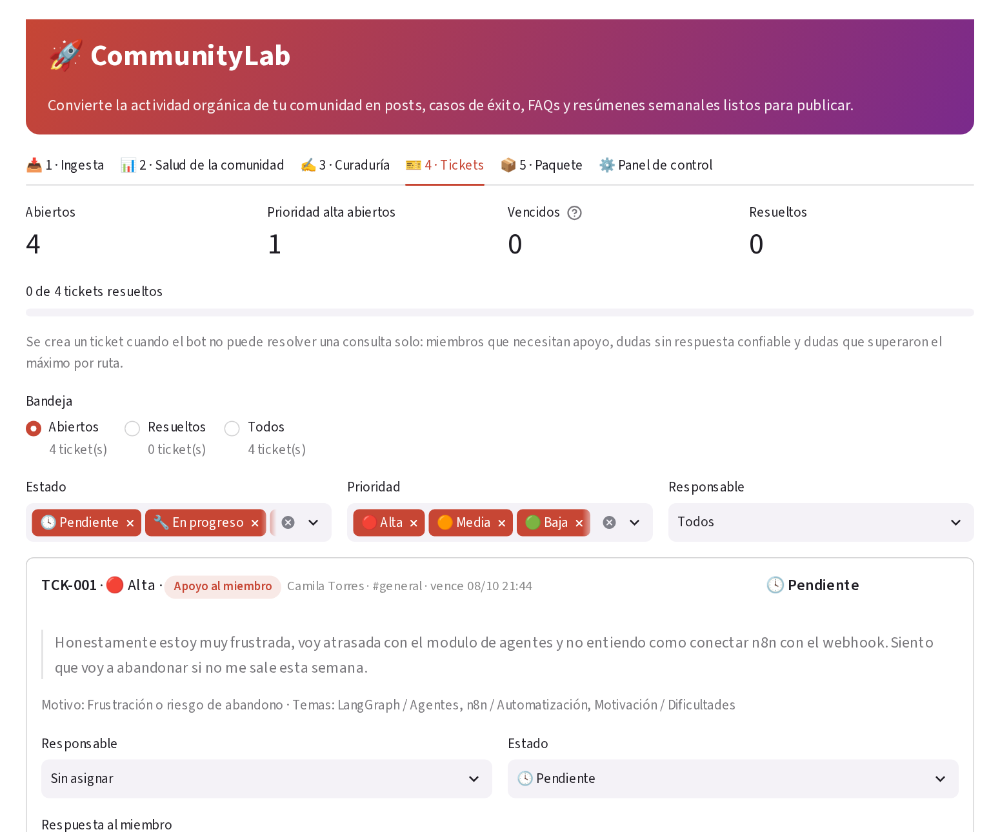
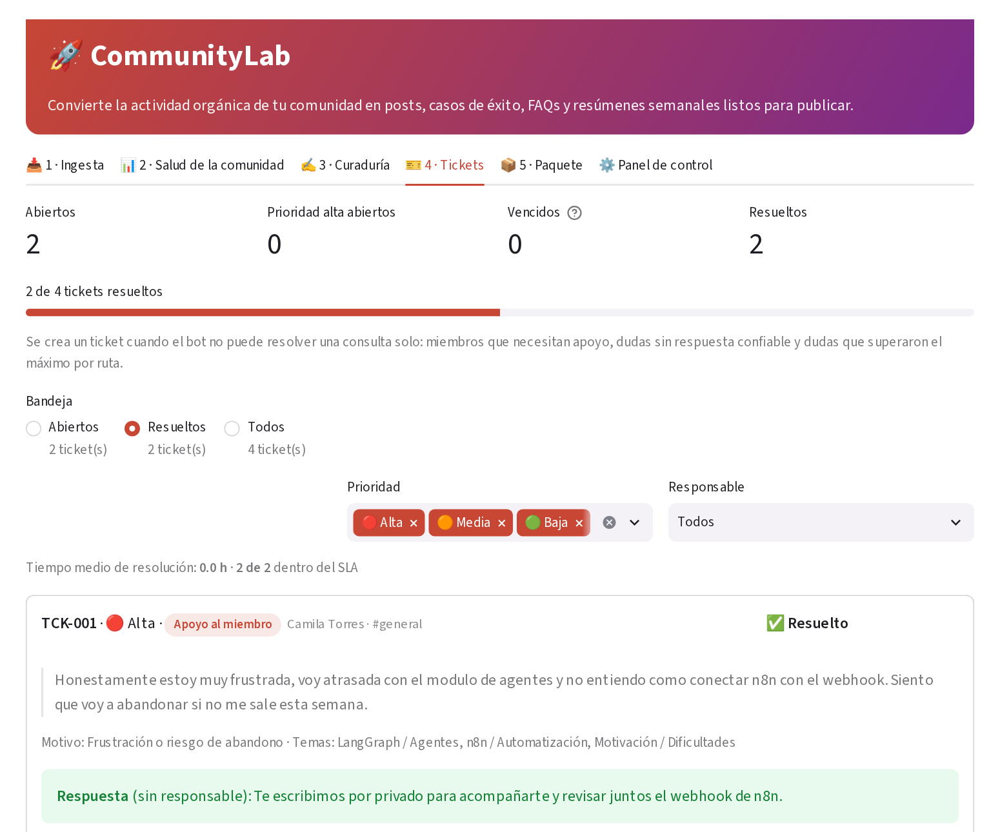
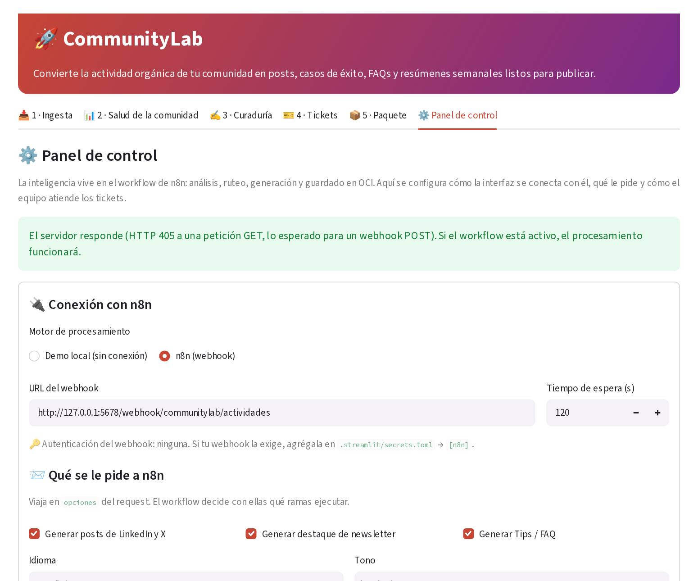
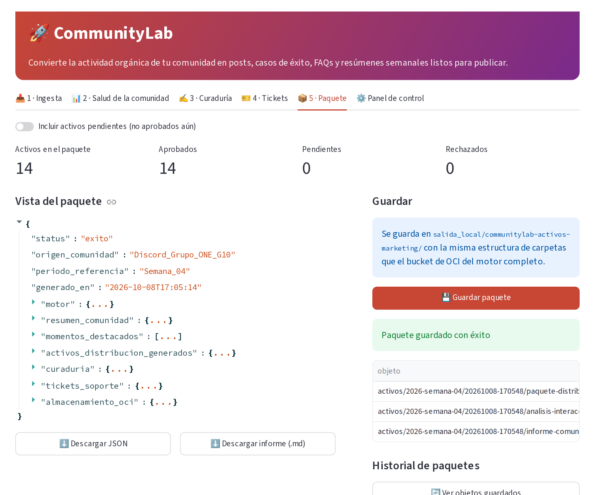
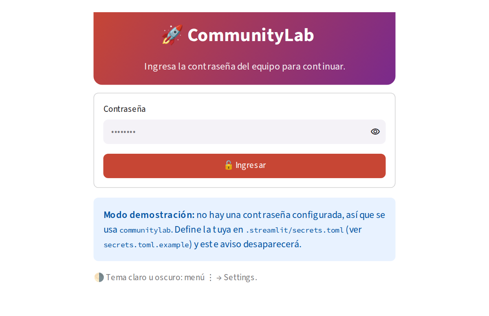
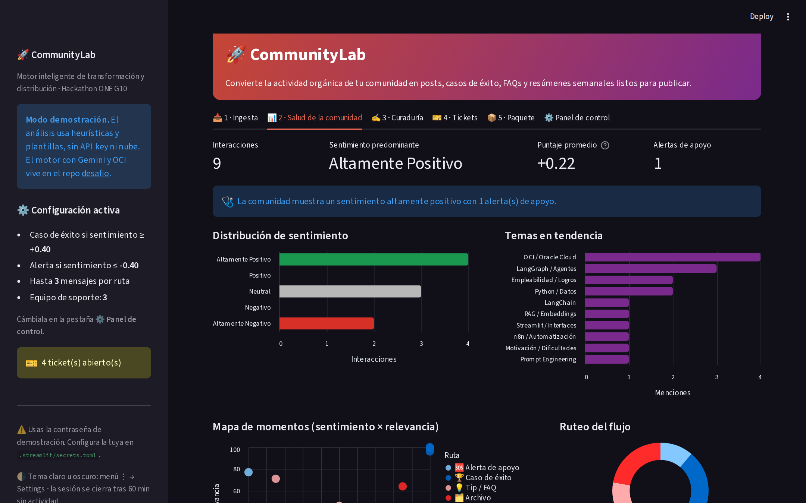

<div align="center">

# 🚀 CommunityLab · Frontend

**Interfaz en Streamlit para convertir las conversaciones de una comunidad tech en contenido listo para publicar.**

Carga un lote de mensajes, muestra la salud de la comunidad, permite al equipo aprobar los posts, casos de éxito y FAQs generados, y deriva a tickets lo que el bot no puede resolver solo. Se conecta al workflow de n8n o funciona sola en modo demo, con acceso por contraseña y tema claro u oscuro.


*Hackathon ONE G10 · Oracle Next Education + Alura · Reto 3*


</div>

---

## Qué es este repositorio

Es la **capa de presentación** de CommunityLab, separada del motor de IA para que cualquiera pueda clonarla y probarla en un minuto.

| Repositorio | Contenido |
|---|---|
| **desafio2** (este) | Interfaz Streamlit que se conecta al workflow de **n8n**, con un motor de demostración para probarla sin conexión. |
| [**desafio**](https://github.com/DiegoTCobba/desafio) | Proyecto completo: análisis con Google Gemini vía LangChain y persistencia en OCI Object Storage. |

El motor de demostración (`motor_demo.py`) respeta el mismo contrato de datos que el workflow de n8n, así que la interfaz funciona igual en ambos modos.

## ✨ Funcionalidades

| Pestaña | Qué hace |
|---|---|
| 📥 **Ingesta** | Carga el lote de ejemplo, un JSON o CSV, o un JSON pegado. Tabla editable antes de procesar y progreso paso a paso. |
| 📊 **Salud de la comunidad** | Métricas, distribución de sentimiento, temas en tendencia, mapa sentimiento × relevancia, reparto por ruta, ranking explicado y alertas de miembros que necesitan apoyo. |
| ✍️ **Curaduría** | Cada activo se edita, aprueba, rechaza o restablece. Filtros por tipo y estado, contador de caracteres para X, vista previa y barra de avance. |
| 🎫 **Tickets** | Cola de las consultas que el bot no pudo resolver solo: miembros que necesitan apoyo, dudas sin respuesta confiable y dudas que superaron el máximo por ruta. Bandejas **Abiertos / Resueltos / Todos**, prioridad, SLA y vencimiento, responsable, respuesta, historial, escalar o reabrir, tickets manuales y exportación a CSV. En **Resueltos** se ve la respuesta, quién la dio, cuánto tardó y si cumplió el SLA. |
| 📦 **Paquete** | Arma el paquete solo con lo aprobado (con el resumen de tickets), lo descarga en JSON o Markdown y lo guarda localmente. Si n8n ya subió el paquete a OCI, muestra el bucket y la ruta. |
| ⚙️ **Panel de control** | Conexión con n8n (URL del webhook, tiempo de espera, prueba de conexión), las `opciones` que se envían al workflow (qué activos generar, idioma, tono), el equipo de soporte y los SLA. Las reglas del motor de demostración quedan aparte, porque con n8n viven en el workflow. |

### Del ticket al contenido

Cuando el equipo resuelve una duda técnica, la respuesta pasa automáticamente al borrador del FAQ, que vuelve a **Curaduría** marcado como *listo para revisión*. Así, la pregunta que el bot no supo responder termina convertida en contenido para la comunidad.

| Origen del ticket | Prioridad | SLA por defecto |
|---|---|---|
| Alerta de apoyo (frustración o riesgo de abandono) | 🔴 Alta | 4 h |
| Duda que el bot no puede responder, relevancia ≥ 60 | 🟠 Media | 24 h |
| Duda con menor relevancia o que superó el máximo por ruta | 🟢 Baja | 72 h |

## 🖥 Capturas

| Ingesta | Curaduría |
|---|---|
|  |  |
| **Tickets abiertos** | **Tickets resueltos** |
|  |  |
| **Panel de control (conectado a n8n)** | |
|  | |
| **Ranking y alertas** | **Paquete** |
|  |  |

## 🔌 Conexión con n8n

La inteligencia del proyecto vive en el workflow de n8n: validación, análisis con LLM, ruteo, generación de activos, persistencia y subida a OCI. Esta interfaz es la capa de operación: envía el lote, muestra el resultado y gestiona la curaduría y los tickets.

| Modo | Qué hace **Procesar lote** |
|---|---|
| **n8n (webhook)** | Envía el lote por `POST` al webhook y muestra lo que devuelve el workflow. |
| **Demo local** | Usa `motor_demo.py` (heurísticas y plantillas) para probar la interfaz sin conexión. |

**Request** que envía la interfaz:

```json
{
  "origen_comunidad": "Discord_Grupo_ONE_G10",
  "periodo_referencia": "Semana_04",
  "interacciones": [{"autor": "...", "canal": "...", "tipo": "...", "texto": "..."}],
  "opciones": {"generar_linkedin": true, "generar_newsletter": true, "generar_faq": true,
               "idioma": "es", "tono": "inspirador"}
}
```

**Respuesta** que entiende (`n8n_cliente.py`): el formato del enunciado del reto, con `resumen_comunidad`, `activos_distribucion_generados` (`post_linkedin`, `destaque_newsletter_semanal`, `sugerencia_contenido_faq`, en singular o en listas), `almacenamiento_oci`, `id_lote` y `estado_lote`. También acepta una lista `activos` con `tipo_activo` = `LINKEDIN | NEWSLETTER | FAQ`, como en el esquema de base de datos.

- Un FAQ con `status: "derivado_a_mentoria"` se convierte en ticket.
- `estado_lote: "parcial"` muestra un aviso; `"fallido"` o un HTTP 4xx/5xx muestran el error con una pista de qué revisar.
- **Recomendado:** que el workflow devuelva también `analisis`, una lista con `autor`, `canal`, `texto`, `sentimiento` (número o etiqueta), `tipo_insight`, `temas`, `relevancia` y `requiere_apoyo` por interacción. Sin ella, el tablero de salud muestra solo el resumen y no se crean tickets de alerta de apoyo.

**Configurar:** pega la URL en el Panel de control, o déjala fija en `.streamlit/secrets.toml`:

```toml
[n8n]
webhook_url = "https://tu-n8n/webhook/communitylab/actividades"
# header_name = "X-CommunityLab-Token"   # si el webhook usa Header Auth
# header_value = "un-token-largo-y-secreto"
```

El token nunca se muestra en la interfaz. **Probar conexión** hace un `GET` a la URL, así que no crea lotes en tu base de datos.

## 🔐 Acceso con contraseña

La app no muestra nada hasta ingresar la contraseña del equipo.

| | |
|---|---|
|  | - Se compara el **hash SHA-256** en tiempo constante; la contraseña nunca queda en la sesión.<br>- **5 intentos** fallidos bloquean el ingreso por 30 segundos.<br>- La sesión se cierra tras **60 minutos** sin actividad (configurable).<br>- Botón **Cerrar sesión** en la barra lateral. |

**Configurar tu contraseña:** copia `.streamlit/secrets.toml.example` como `.streamlit/secrets.toml` (ya está en `.gitignore`) y pon el hash:

```bat
python -c "import hashlib; print(hashlib.sha256('mi-clave-segura'.encode()).hexdigest())"
```

```toml
[auth]
password_sha256 = "el-hash-que-generaste"
minutos_sesion = 60
```

También acepta las variables de entorno `COMMUNITYLAB_PASSWORD_SHA256` o `COMMUNITYLAB_PASSWORD`. Si no configuras ninguna, la app usa la contraseña de demostración **`communitylab`** y lo avisa en la pantalla de ingreso.

> Al desplegar en Streamlit Community Cloud, pega el bloque `[auth]` en **Settings → Secrets** de la app.

## 🌗 Modo oscuro

La app trae una paleta clara y otra oscura con los colores de la marca (`.streamlit/config.toml`). Por defecto sigue el tema del sistema; cada persona puede elegir **Claro / Oscuro** desde el menú **⋮ → Settings**, y Streamlit recuerda su elección.



## ⚡ Cómo ejecutarlo

```bat
git clone https://github.com/DiegoTCobba/desafio2.git
cd desafio2
python -m venv .venv
.venv\Scripts\python.exe -m pip install -r requirements.txt
.venv\Scripts\python.exe -m streamlit run app.py
```

> En macOS / Linux: `source .venv/bin/activate` y luego `streamlit run app.py`.

Ingresa con tu contraseña (o `communitylab` si aún no configuraste una), pulsa **Cargar lote de ejemplo** → **Procesar lote** y recorre las pestañas.

### Formato de entrada

JSON con el formato del reto, o CSV con las columnas `autor, canal, tipo, texto`:

```json
{
  "origen_comunidad": "Discord_Grupo_ONE_G10",
  "periodo_referencia": "Semana_04",
  "interacciones": [
    {"autor": "Mariana Souza", "canal": "#logros-y-empleos", "tipo": "testimonio",
     "texto": "Comunidad, quede seleccionada para el puesto de Desarrolladora Junior de IA! ..."}
  ]
}
```

## 🧩 Decisiones de interfaz

- **El flujo sigue el trabajo real** de un community manager: cargar, entender la semana, revisar y guardar.
- **Humano en el circuito**: nada entra al paquete sin aprobación, salvo que se active la opción de incluir pendientes.
- **Cada decisión se explica**: el ranking muestra categoría, puntaje, ruta y justificación de cada mensaje.
- **Las alertas no generan contenido**: un mensaje con frustración se muestra al equipo, no se convierte en publicidad.
- **Nada se pierde en el camino**: lo que el bot no resuelve queda como ticket con responsable y vencimiento.
- **Una sola fuente de verdad**: las reglas de IA viven en n8n; el panel solo configura la conexión, lo que se pide y la atención de tickets.
- **Estado estable**: las etiquetas de las pestañas son fijas, porque Streamlit reinicia la navegación si cambian.

## 🧪 Pruebas

```bat
.venv\Scripts\python.exe -m pip install -r requirements-dev.txt
.venv\Scripts\python.exe -m pytest tests -q
```

**24 pruebas** con **Streamlit AppTest** y un **n8n simulado** (un servidor HTTP local con el contrato del reto): el flujo completo (cargar, procesar, aprobar, editar y guardar), la creación de tickets, que resolver exija una respuesta y la envíe al FAQ, los tickets manuales, que el panel de control guarde, valide, restablezca y reprocese, el acceso (nada visible sin contraseña, bloqueo por intentos, ingreso por hash, cierre de sesión), la bandeja de resueltos, y la integración con n8n: el request lleva las `opciones`, la respuesta se adapta, los FAQ derivados generan tickets, los errores HTTP se muestran y la prueba de conexión no crea lotes. Se ejecutan en cada push con GitHub Actions.

## 📁 Estructura

```text
app.py                  interfaz Streamlit (6 pestañas)
acceso.py               pantalla de ingreso con contraseña, bloqueo y expiración de sesión
n8n_cliente.py          cliente del webhook de n8n y adaptador de su respuesta
motor_demo.py           motor de demostración: heurísticas, ruteo, plantillas, tickets y paquete
data/                   lote de ejemplo del reto (9 mensajes)
tests/test_app.py       24 pruebas de interfaz, motor, acceso y n8n
.streamlit/config.toml  temas claro y oscuro
.streamlit/secrets.toml.example  plantilla para la contraseña
docs/img/               capturas
```

## 👤 Autor

**Diego** · [@DiegoTCobba](https://github.com/DiegoTCobba)

---

<sub>Proyecto desarrollado para el Hackathon ONE G10 (Oracle Next Education + Alura). Licencia MIT.</sub>
